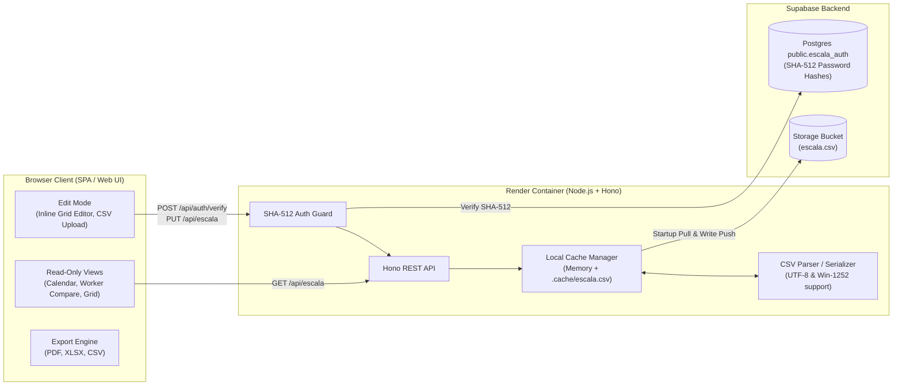

# Escala de Trabalho Visualizer & Editor — Architecture & Implementation Plan (`PLAN.md`)

## 1. Project Overview

**`ti-escala`** is a brand-new, containerized web application built with **Node.js** and **Hono** to visualize, compare, edit, and export employee work schedules (*Escala de Trabalho*). It is designed from the ground up as a modern replacement for `https://escala-calendar.onrender.com` without reusing any legacy code.

### Core Capabilities
1. **Default Read-Only Mode**: Anyone with the link can browse schedules, filter by sector/role/worker, compare workers, and export reports (`PDF`, `XLSX`, `CSV`).
2. **Password-Protected Edit Mode**: Unlockable via **`administrator`** (Boss) or **`system`** (Developer) credentials verified against a **SHA-512** hashed password table in **Supabase Postgres (`public` schema)**.
3. **Resilient Storage & Local Cache**:
   - The canonical `escala.csv` lives in a **Supabase Storage Bucket**.
   - Because Render free/starter instances spin down on inactivity, the Hono server downloads the latest `escala.csv` from Supabase on startup into a fast local cache (in-memory + local disk cache) and pushes every edit back to the Supabase bucket immediately.
4. **Rich Visualizations**:
   - **Calendar View**: Monthly and weekly calendar views displaying who is working, shift hours, days off (`FOLGA`), and vacations (`FÉRIAS`).
   - **Per-Worker & Worker Comparison View**: Individual worker schedule cards/timelines and side-by-side multi-worker comparison to spot coverage gaps or overlapping days off.
   - **Excel-like Grid View & Editor**: Frozen metadata columns + scrollable date columns resembling Excel, supporting inline cell editing and CSV upload when in Edit Mode.
5. **Multi-Format Export**: One-click export to **PDF**, **XLSX**, and **CSV**.

---

## 2. System Architecture



---

## 3. Data Model (`escala.csv` Structure)

Based on the Excel-exported semicolon-delimited (`;`) CSV format:

### 3.1 Fixed Worker Metadata Columns (Columns 0–13)
| Col Index | CSV Header | Internal Field | Example | Description |
| :---: | :--- | :--- | :--- | :--- |
| `0` | `MATRICULA` | `matricula` | `74308` | Employee ID |
| `1` | `Nome` | `nome` | `Adison Borges dos Santos` | Employee Full Name |
| `2` | `SETOR` | `setor` | `TI MANHÃ`, `TI NOITE`, `NEGÓCIOS NOITE`, `MADRUGADA` | Department / Shift Group |
| `3` | `FUNÇÃO` | `funcao` | `N1`, `N2`, `N3` | Role / Support Tier |
| `4` | `SABADO` | `sabado` | `S` / `N` | Works Saturdays flag |
| `5` | `DOMINGO` | `domingo` | `S` / `N` | Works Sundays flag |
| `6` | `ESCALA` | `escalaSemanal` | `08:48` | Standard weekday shift duration |
| `7` | `ENTR` | `entrada` | `08:00` | Shift start time |
| `8` | `INI INTER` | `inicioIntervalo` | `12:30` | Break/lunch start time |
| `9` | `RET INTER` | `retornoIntervalo` | `13:42` | Break/lunch end time |
| `10` | `ESCALA` | `escalaFimDeSemana` | `07:20` / `08:48` | Second `ESCALA` column (weekend/alternate workload) |
| `11` | ` SAI` | `saida` | `18:00` | Shift end time (note leading space in raw CSV header) |
| `12` | `TOTAL INTERVALO` | `totalIntervalo` | `01:12` | Total break duration |
| `13` | `TOTAL LOGADO` | `totalLogado` | `10:00` | Total span from entry to exit |

### 3.2 Dynamic Date Columns (Column 14+)
- **Header Format**: `DD/MM/YYYY` (e.g., `28/09/2026`, `29/09/2026`, ..., `02/12/2026`).
- **Cell Values**:
  - **Work Shift**: Time duration string such as `08:48`, `8:48`, `07:20` (indicates the worker works on that date according to their `ENTR`–`SAI` schedule).
  - **Day Off**: `FOLGA`
  - **Vacation**: `FÉRIAS`
  - **Extensible Statuses**: Support additional markers (`FERIADO`, `ATESTADO`, etc.) if entered.

### 3.3 Encoding & Sanitization Rules
- Excel in Portuguese locales often exports `;`-separated CSVs encoded in **Windows-1252 (`latin1`)** rather than UTF-8.
- The parser will inspect byte sequences on upload/download: if invalid UTF-8 sequences (`0xFFFD` replacement characters) are detected, it will decode via `windows-1252` (`TextDecoder('windows-1252')`) and normalize in-memory strings to clean UTF-8.
- Empty trailing rows (`;;;;;...`) generated by Excel will be stripped on parse and omitted on export.

---

## 4. Supabase Integration

### 4.1 Authentication Schema (`sql/init_auth.sql`)
We will provide a standalone SQL script (`sql/init_auth.sql`) for the `public` schema in Supabase:

```sql
-- Enable pgcrypto if DB admin wants to hash directly inside SQL
CREATE EXTENSION IF NOT EXISTS pgcrypto;

CREATE TABLE IF NOT EXISTS public.escala_auth (
    role TEXT PRIMARY KEY CHECK (role IN ('administrator', 'system')),
    password_hash TEXT NOT NULL, -- Hex-encoded SHA-512 hash (128 hex chars)
    updated_at TIMESTAMPTZ NOT NULL DEFAULT NOW(),
    description TEXT
);

-- Enable RLS so anon keys cannot read hashes directly if using service role,
-- or restrict to read-only verification if needed.
ALTER TABLE public.escala_auth ENABLE ROW LEVEL SECURITY;

-- Example: Insert/Reset passwords manually using SHA-512 in Supabase SQL Editor:
-- INSERT INTO public.escala_auth (role, password_hash, description)
-- VALUES
--   ('administrator', encode(digest('YOUR_ADMIN_PASSWORD', 'sha512'), 'hex'), 'Boss / Escala Manager'),
--   ('system',        encode(digest('YOUR_SYSTEM_PASSWORD', 'sha512'), 'hex'), 'Developer / System Admin')
-- ON CONFLICT (role) DO UPDATE
-- SET password_hash = EXCLUDED.password_hash,
--     updated_at = NOW();
```

- **How Verification Works**:
  1. User enters password in the UI (or sends it in `x-escala-password` / bearer header).
  2. Backend computes `crypto.createHash('sha512').update(plainPassword, 'utf8').digest('hex')`.
  3. Backend queries `public.escala_auth` and compares the computed SHA-512 hex digest against `administrator` and `system` records using constant-time comparison (`crypto.timingSafeEqual`).
  4. Both `administrator` and `system` receive full Edit Mode privileges (and the matched role name is returned so the UI can display e.g. `Modo Edição (Administrator)` or `Modo Edição (System)`).

### 4.2 Supabase Storage Bucket & Ephemeral Runtime Cache Sync
1. **No Bundled `escala.csv` in Repo/Container**:
   - The repository and Docker container will **not** ship with a local `escala.csv`. The initial `escala.csv` is manually uploaded to the Supabase Storage Bucket by the administrator.
   - Local cache (`./.cache/escala.csv` + in-memory store) exists **strictly as an ephemeral runtime cache** while the Render container instance is running.
2. **Startup Sync & Missing-File Abort Behavior**:
   - On server startup, Hono downloads `escala.csv` from the configured Supabase bucket (`SUPABASE_BUCKET`, path `escala.csv`) and caches it locally for the lifetime of the running instance.
   - **If `escala.csv` is not present in the bucket** (or Supabase Storage cannot be reached):
     - The server logs a critical startup error and enters an `ERROR_MISSING_CSV` state, aborting main schedule visualization/editing functionality.
     - Schedule API endpoints return `503 Service Unavailable` with a structured error payload, and the frontend renders a clear error screen stating that `escala.csv` was not found in the Supabase bucket (with a button to retry startup sync after manual upload).
3. **Write-Through Cache on Update**:
   - When an authenticated `administrator` or `system` user edits cells, adds/edits a worker, or uploads a new CSV:
     1. Backend validates the structure and serializes to semicolon-delimited CSV.
     2. Backend uploads (`upsert: true`) the new `escala.csv` to the Supabase Storage Bucket.
     3. Backend updates the ephemeral runtime cache (`./.cache/escala.csv` and in-memory state).

---

## 5. Backend API Design (Node.js + Hono)

| Method | Endpoint | Auth | Description |
| :--- | :--- | :--- | :--- |
| `GET` | `/healthz` | Public | Health check endpoint for Render container probes; reports cache & Supabase sync status. |
| `GET` | `/api/escala` | Public | Returns parsed schedule JSON (`workers`, `dates`, `sectors`, `roles`, `lastSyncedAt`) from local cache. |
| `GET` | `/api/escala/raw` | Public | Downloads the raw `escala.csv` file directly from cache. |
| `POST` | `/api/auth/verify` | Public | Accepts `{ password }`, hashes with SHA-512, checks `public.escala_auth`, returns `{ valid: true, role: 'administrator' \| 'system' }`. |
| `PUT` | `/api/escala` | Admin/System | Updates schedule data (full dataset or patched cells/rows), serializes to CSV, pushes to Supabase bucket, and updates local cache. |
| `POST` | `/api/escala/upload` | Admin/System | Accepts a new `escala.csv` file upload, validates format, normalizes encoding, pushes to Supabase bucket, and updates local cache. |
| `POST` | `/api/escala/sync` | Admin/System | Forces a fresh pull of `escala.csv` from Supabase Storage into the local cache. |

---

## 6. Frontend Visualizations & Features

### 6.1 Global Toolbar & Filters
- **Mode Indicator**: Clear badge showing `Somente Leitura (Read-Only)` with an **"Entrar no Modo Edição"** button (opens password modal), or `Modo Edição Ativo (Administrator / System)` with **"Salvar Alterações"**, **"Importar CSV"**, and **"Sair"**.
- **Global Filters**:
  - **Sector (`SETOR`)**: Multi-select or pills (`Todos`, `TI MANHÃ`, `TI NOITE`, `NEGÓCIOS MANHÃ`, `NEGÓCIOS NOITE`, `MADRUGADA`).
  - **Role (`FUNÇÃO`)**: (`Todas`, `N1`, `N2`, `N3`).
  - **Worker Search & Sort**: Instant search by `Nome` or `MATRICULA`; sort by Name, Matricula, Sector, Role, or Entry Time (`ENTR`).
  - **Date / Period Picker**: Jump to specific month (`Outubro 2026`, `Novembro 2026`, etc.), week, or custom date range.

### 6.2 View 1: Calendar Visualization (`Calendário`)
- **Monthly & Weekly Calendar Grid**:
  - Each day cell summarizes coverage: count of working employees vs `FOLGA` vs `FÉRIAS`, expandable/hoverable to see the exact list of workers and their shift times (`ENTR` - `SAI`, break `INI INTER` - `RET INTER`).
- **Single-Worker Calendar Mode**:
  - When a specific worker is selected, the calendar turns into a personal monthly schedule clearly color-coding working days (with exact shift hours & break times), `FOLGA`, and `FÉRIAS`, plus summary KPIs (total working days, days off, vacation days, weekend work count).

### 6.3 View 2: Worker Comparison (`Comparar Colaboradores`)
- **Multi-Worker Selector**: Pick 2 or more workers (or an entire sector/tier) to compare side-by-side.
- **Aligned Timeline / Matrix**:
  - Shows aligned day-by-day strips for the selected workers so managers can immediately see when two workers share a `FOLGA`, when someone is on `FÉRIAS`, or how shift hours (`ENTR`–`SAI`) overlap on any given date.
  - Coverage conflict highlights (e.g., highlighting days where too many people in the same `SETOR` / `FUNÇÃO` are off).

### 6.4 View 3: Excel-like Grid View & Editor (`Planilha / Grade`)
- **Spreadsheet UI**:
  - Sticky left columns (`MATRICULA`, `Nome`, `SETOR`, `FUNÇÃO`, `ENTR`, `SAI`, etc.) and horizontally scrollable date columns (`DD/MM/YYYY`) with weekday labels (`Seg`, `Ter`, `Qua`, `Qui`, `Sex`, `Sáb`, `Dom`) and weekend column highlighting.
  - Color-coded cells:
    - Working shift (`08:48`, `07:20`): Emerald/Green badge
    - `FOLGA`: Amber/Orange badge
    - `FÉRIAS`: Sky/Indigo badge
- **Edit Mode Capabilities**:
  - Click or keyboard-navigate cells to toggle or edit values (`08:48`, `07:20`, `FOLGA`, `FÉRIAS`, or custom value).
  - Edit worker metadata (`SETOR`, `FUNÇÃO`, `ENTR`, `INI INTER`, `RET INTER`, `SAI`, etc.) and add/delete worker rows.
  - Dirty-state tracking (highlights unsaved modified cells) with a single **"Salvar no Supabase"** action (or auto-save option) and **"Upload Novo CSV"**.

### 6.5 Export Engine (`PDF`, `XLSX`, `CSV`)
- **CSV Export (`.csv`)**: Exports the semicolon-delimited (`;`) file matching the exact Excel layout.
- **Excel Export (`.xlsx`)**: Generates a formatted `.xlsx` workbook (using `exceljs` or `xlsx`) with frozen headers, column widths, and color-coded status cells (`FOLGA`, `FÉRIAS`, work hours).
- **PDF Export (`.pdf`)**: Generates a clean, landscape-oriented printable PDF report (via `jspdf` + `jspdf-autotable`) respecting the active view/filters (full grid, monthly calendar, or worker comparison).

---

## 7. Containerization & Render Deployment

- **Multi-stage `Dockerfile`**:
  - `builder` stage: Installs dependencies and builds the frontend + TypeScript backend bundle.
  - `runner` stage: Lightweight `node:22-alpine` image running as non-root user, exposing `PORT` (default `3000` / `10000` on Render).
- **Environment Variables**:
  - `PORT` (provided by Render or `.env`, e.g., `35001` in local dev; dynamically read by both `src/server/config.ts` and `vite.config.ts` proxy)
  - `SUPABASE_URL`
  - `SUPABASE_SERVICE_ROLE_KEY` (or `SUPABASE_KEY` with storage & auth table access)
  - `SUPABASE_BUCKET` (e.g. `escala_storage`)
  - `SUPABASE_FILE_PATH` (default `escala.csv`)
  - `SUPABASE_AUTH_TABLE` (default `escala_auth`)


---

## 8. Frontend Redesign & Android WebView Integration (`TASK-016`)

### 8.1 Goal
- Modern, simple-for-end-user UI, inspired visually by `escala-calendar.onrender.com` (no code or assets copied, per Section 4 of `AGENTS.md`).
- The Android app stops bundling a local copy of the schedule. It opens this web app in a WebView instead.

### 8.2 Worker Selection Persistence ("whoami")
- The selected worker (`matricula`) is stored in `localStorage` under a single key (for example `escala.whoami`). Cookies are not used, because they would be sent to the server on every request for no benefit.
- On load, the app reads the stored `matricula`. If it matches a worker in the dataset, that worker is pre-selected in the Calendário (por colaborador) view and in the Comparar view.
- If no value is stored, or the stored worker no longer exists, the app falls back to the first worker, as it does today.
- Every read and write is wrapped in try/catch. The page must still render if storage is blocked or cleared.
- This is a per-viewer convenience, not shared state, so `localStorage` is the right fit.

### 8.3 WebView Compatibility Requirements
- No dependency on the `/api/escala/raw` download route for display. That route stays available for export and for backward compatibility.
- The page works inside an Android WebView: relative API paths, no `window.open` for core flows, no reliance on file downloads for viewing (exports may still download).
- Layout is responsive from phone width (about 360px) up, with no horizontal page scroll outside the Grid view, which scrolls inside its own container.
- Open question for the Android side: whether the WebView has DOM storage enabled (`domStorageEnabled = true`). Without it, `localStorage` does not persist between app launches. The Android app must enable it.
- Optional follow-up (not in this task): accept `?matricula=` in the URL so the Android app can pass the selection explicitly as a fallback.

### 8.4 Visual Direction
- Simplified default: one clear entry screen with the team's current status (who is working today, days off, vacations), with the detailed views one tap away.
- Clean card-based layout, large touch targets, a neutral palette with clear status colors (working, `FOLGA`, `FÉRIAS`), and light/dark support following the system setting.
- Keep all existing features (filters, three views, Edit Mode, exports). Only their presentation changes unless listed otherwise.

### 8.5 Acceptance Criteria
1. Selecting a worker and reloading (or reopening the Android WebView) keeps that worker selected.
2. Clearing `localStorage` returns the app to the default selection without errors.
3. The app renders at 360px width with no horizontal page scroll on the default view.
4. `GET /api/escala/raw` still returns the CSV as before (covered by `tests/backend.test.ts`).
5. Edit Mode, exports, and the missing-CSV abort screen still work.
